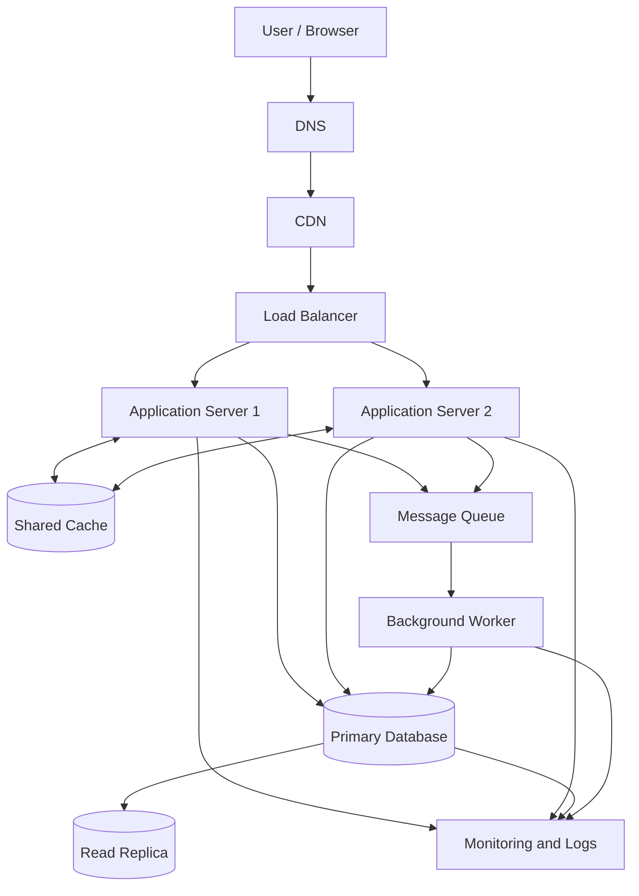

# QuickNotes — System Architecture

## 1. Overview

QuickNotes is a note-taking application that allows users to create, view, update, delete, and organise their notes. The current frontend uses the JSONPlaceholder API for practice. This document describes a proposed production architecture designed to support approximately one million registered users.

The design prioritises availability, security, scalability, and reliable storage of user notes.

## 2. Functional Requirements

The system must allow users to:

- Register and log in securely.
- Create notes with a title and body.
- View a list of their notes and retrieve individual notes.
- Update and delete their own notes.
- Organise notes using tags.
- Search and filter their notes.
- Receive clear success and error messages.

## 3. Non-Functional Requirements

- **Scalability:** Support one million registered users and increased traffic.
- **Availability:** Continue operating if one application server fails.
- **Performance:** Aim for common note-reading requests to complete within 300 ms at the 95th percentile, under the expected load.
- **Security:** Use HTTPS, authentication, authorisation, input validation, and encrypted storage where appropriate.
- **Data integrity:** Prevent users from accessing or modifying other users' notes.
- **Maintainability:** Separate the frontend, API, database, caching, and background processing responsibilities.
- **Recoverability:** Back up the database and test the restoration process.

These are design targets, not measured performance results.

## 4. Assumptions and Capacity Estimates

The following estimates are planning assumptions rather than measured production traffic.

| Metric                            | Assumption or calculation                  |                       Estimate |
| --------------------------------- | ------------------------------------------ | -----------------------------: |
| Registered users                  | Given design target                        |                      1,000,000 |
| Daily active users                | 10% of registered users                    |                        100,000 |
| Reads per active user per day     | 50 requests                                |            5,000,000 reads/day |
| Writes per active user per day    | 2 requests                                 |             200,000 writes/day |
| Average read rate                 | 5,000,000 / 86,400 seconds                 |                58 reads/second |
| Average write rate                | 200,000 / 86,400 seconds                   |              2.3 writes/second |
| Peak read rate                    | 5 × average read rate                      |         About 290 reads/second |
| Peak write rate                   | 5 × average write rate                     |         About 12 writes/second |
| Average notes per registered user | 100 notes                                  |              100,000,000 notes |
| Average stored data per note      | 2 KB, including estimated metadata         |                         200 GB |
| Annual growth                     | 2 additional notes per active user per day | About 146 GB/year of note data |

### Estimate explanations

**Reads per day**

100,000 daily active users × 50 reads = 5,000,000 reads per day.

**Writes per day**

100,000 daily active users × 2 writes = 200,000 writes per day.

**Average requests per second**

Average requests per second = daily requests ÷ 86,400 seconds.

The peak estimates assume traffic can reach five times the daily average. Real traffic may be higher, so monitoring and load testing are required.

**Storage**

100 million notes × 2 KB per note = approximately 200 GB of note data.

Annual growth assumes each daily active user creates two additional notes each day:

100,000 users × 2 notes × 365 days × 2 KB = approximately 146 GB per year.

These storage estimates exclude database indexes, replicas, backups, logs, attachments, and additional metadata. Actual capacity requirements will therefore be higher.

## 5. Proposed System Architecture

The diagram shows how client requests travel through the system and how data and background tasks are handled.

### Component responsibilities

1. **Client/browser:** Displays the interface and sends API requests to manage notes.
2. **DNS:** Resolves the application domain to the appropriate network endpoint.
3. **CDN:** Caches and serves static assets such as JavaScript, CSS, and images from locations closer to users.
4. **Load balancer:** Distributes API requests across healthy application servers.
5. **Application servers:** Run API logic, authenticate users, validate input, enforce permissions, and communicate with other services.
6. **Shared cache:** Stores frequently accessed data, such as note lists, to reduce repeated database reads. Cached data must be invalidated or updated after relevant changes.
7. **Primary database:** Stores authoritative user, note, tag, and relationship records and handles writes.
8. **Read replica:** Serves eligible read requests to reduce pressure on the primary database. Replication lag means recent writes might not appear immediately.
9. **Message queue:** Holds background jobs so that non-essential tasks do not delay API responses.
10. **Background worker:** Processes queued tasks, such as sending notifications or generating exports.
11. **Monitoring and logs:** Collect request latency, error rates, server health, database performance, and worker failures.

## 6. Request Flows

### 6.1 GET /notes — Retrieve Notes

1. The user opens the notes page in the browser.
2. The browser sends `GET /notes` over HTTPS with an authentication token.
3. DNS resolves the domain, and the CDN serves any eligible cached static assets.
4. The load balancer forwards the API request to a healthy application server.
5. The application server validates the token and checks that the user is authorised.
6. The server checks the shared cache for the user's note list.
7. If the data is cached and valid, the server returns it; otherwise, it queries the database.
8. The server returns the user's notes as JSON with HTTP `200 OK`.
9. The client renders the notes and displays an empty state if no notes exist.

The API must scope the query to the authenticated user. It must never return another user's private notes.

### 6.2 POST /notes — Create a Note

1. The user fills in the title and body and submits the form.
2. The browser sends `POST /notes` over HTTPS with an authentication token and a JSON request body.
3. The load balancer forwards the request to a healthy application server.
4. The server validates authentication, authorisation, title length, and request data.
5. The server inserts the new note into the primary database.
6. The server invalidates or updates the relevant cached note list.
7. If a background task is required, the server places a job on the message queue.
8. The server returns the created note as JSON with HTTP `201 Created`.
9. The client displays a success message and updates the interface.

If validation fails, the server returns an appropriate `4xx` error. If the database write fails, the server returns an appropriate server error and must not report a successful creation.

## 7. Scalability and Reliability Strategies

- **Horizontal scaling:** Add application servers when request volume increases.
- **Load balancing:** Distribute traffic and stop sending requests to unhealthy servers.
- **Caching:** Reduce repeated database reads, with explicit invalidation after updates.
- **Database optimisation:** Use indexes, pagination, connection pooling, and query monitoring.
- **Read replicas:** Offload suitable read queries from the primary database.
- **Asynchronous processing:** Move suitable non-essential tasks to a queue and background workers.
- **Monitoring and alerting:** Detect high latency, elevated error rates, storage pressure, and service failures.
- **Backups and recovery:** Maintain automated backups and periodically test recovery.

## 8. Design Trade-Offs

### SQL database versus NoSQL database

A relational database such as PostgreSQL is the preferred starting point because notes, users, and tags have clear relationships. Transactions, foreign keys, and constraints help preserve data integrity. A NoSQL database could offer useful flexibility for some workloads, but its data modelling and consistency trade-offs would need to be justified by actual requirements.

### Cache versus consistency

Caching can reduce database load and improve read performance. However, cached note lists may become stale after a user creates, updates, or deletes a note. The system should invalidate or refresh affected cache entries and use the primary database for operations requiring the latest data.

### Read replicas versus immediate consistency

Read replicas distribute read traffic, but changes may take time to replicate. The application can route reads that require immediate consistency to the primary database, while allowing less time-sensitive reads to use replicas.

### Synchronous versus asynchronous processing

Performing every task during an API request is simpler, but it can increase response time. Queues and workers improve responsiveness for non-essential tasks, but introduce additional infrastructure and require retries, monitoring, and duplicate-job protection.

### More servers versus operational complexity

Multiple application servers improve resilience and scalability, but increase deployment and monitoring complexity. The system should begin with a manageable deployment and scale according to measured demand.

## 9. Avoiding Single Points of Failure

- Run at least two application server instances across separate failure domains where possible.
- Configure the load balancer to check server health and route traffic away from failed instances.
- Deploy the primary database with a documented replication and failover strategy.
- Use a highly available cache and message queue, or configure recovery procedures appropriate to the selected services.
- Keep database backups separate from the primary database infrastructure.
- Monitor DNS, CDN, database, queue, and worker health.
- Document recovery procedures and test them regularly.

Two application servers alone do not make the entire system highly available. The database, networking, cache, queue, and other dependencies also need appropriate resilience.

## 10. Conclusion

This architecture provides a starting point for scaling QuickNotes to one million registered users. A load balancer and multiple application servers support horizontal scaling, while a relational database preserves data integrity. Caching, read replicas, and background workers can reduce load and improve responsiveness. Capacity assumptions should be validated with load tests and adjusted using real usage and monitoring data.

The architecture describes a proposed production design. The current learning project is a browser-based client using JSONPlaceholder and does not implement these production services.
